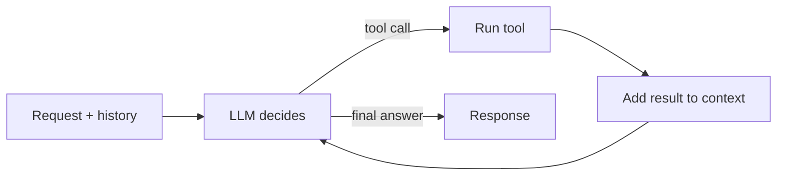

1. Build the context: system prompt, conversation history, available tools, the user's request.
2. Call the model.
3. If the model asks for a tool, run it and add the result to the context. Go back to step 2.
4. If the model answers, return it.

## Stop conditions

The loop must always end. Set limits on:

- Number of steps.
- Total tokens or cost.
- Wall-clock time.

When a limit is hit, return a partial answer or a clear error.

## Agent or workflow

| | Workflow | Agent |
|---|---|---|
| Who decides the steps | Your code | The model |
| Predictability | High | Lower |
| Use when | The steps are known | The steps depend on the input |

Start with a workflow. Use an agent only for the parts where the path really varies. Many production systems are workflows with an agent at one or two steps.

## Multi-agent

Split into several agents when one prompt gets too big or the tools are unrelated. A common pattern is a router or supervisor that hands the request to a specialist agent. Each extra agent adds latency, cost and failure points, so add them only when one agent clearly struggles.
