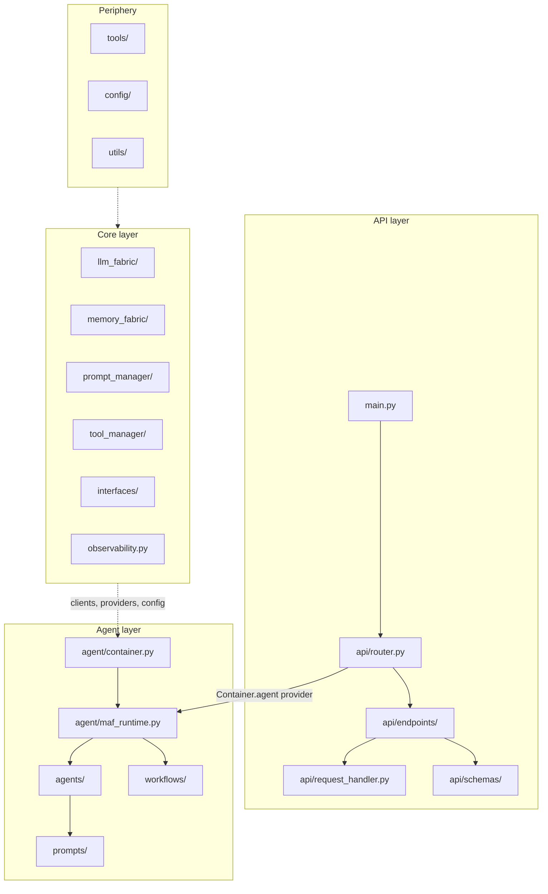

The archetype is a FastAPI service that runs agents through a common runtime. Every new agent reuses the same API, runtime and shared services instead of building its own stack.

## Layers

| Layer | Location | Responsibility |
|---|---|---|
| [API](/agents/pro-code-archetype/api-layer) | `src/main.py`, `src/api/` | FastAPI, middleware, routes, request normalization, DTOs |
| [Agent](/agents/pro-code-archetype/agent-layer) | `src/agent/` | Runtime (`MAFRuntime`), agents, workflows, prompts, dependency injection |
| [Core](/agents/pro-code-archetype/core-layer) | `src/core/` | Interfaces, shared infrastructure components, observability |
| [Periphery](/agents/pro-code-archetype/periphery-layer) | `src/tools/`, `src/config/`, `src/utils/` | Tools, configuration, utilities |

## Diagram

## Topics

- [API layer](/agents/pro-code-archetype/api-layer)
- [Agent layer](/agents/pro-code-archetype/agent-layer)
- [Core layer](/agents/pro-code-archetype/core-layer)
- [Periphery layer](/agents/pro-code-archetype/periphery-layer)
- [Request flow](/agents/pro-code-archetype/request-flow)
- [Design principles](/agents/pro-code-archetype/design-principles)
- [Add a new agent](/agents/pro-code-archetype/add-an-agent)
