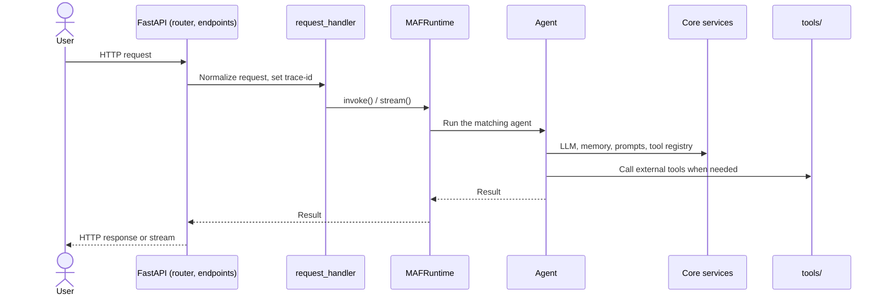

1. The user sends an HTTP request to FastAPI.
2. `api/router.py` matches it to an endpoint in `api/endpoints/`.
3. `api/request_handler.py` normalizes the request and sets the `trace-id`.
4. `agent/maf_runtime.py` runs the matching agent.
5. The agent uses `llm_fabric/`, `memory_fabric/`, `prompt_manager/` and `tool_manager/`.
6. Tools in `tools/` run when the agent calls them.
7. The result returns through FastAPI to the user.
