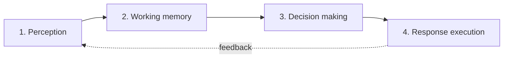

HIPA (Human Information Processing Architecture) is a framework that structures how an LLM processes information, reasons and answers. It borrows its stages from cognitive psychology, where human information processing is described as a flow from perception to action.

The goal is to go beyond generating text. HIPA adds explicit steps for analysis and decision support, so the model helps people understand, evaluate and decide, not only get an answer.

## The four stages



| Stage | Human analogy | What the LLM system does |
|---|---|---|
| Perception | Noticing and interpreting a stimulus | Understand the input, the context and what the user actually needs |
| Working memory | Holding and relating relevant facts | Retrieve and organize the knowledge needed to analyze the problem |
| Decision making | Weighing options against criteria | Compare alternatives, apply explicit criteria and justify the choice |
| Response execution | Acting on the decision | Produce a clear, coherent answer adapted to the user and the context |

### 1. Perception

Identify what is being asked before answering it.

- Restate the request and the underlying goal.
- Detect the user's role, expertise and constraints.
- Flag ambiguity and missing information. Ask, or state the assumption you make.

In a system, this is where you classify intent, extract entities and decide which route or agent handles the request.

### 2. Working memory

Gather only what is relevant and organize it.

- Pull facts from the conversation, documents (RAG), tools or long-term memory.
- Separate facts from assumptions.
- Structure the material: key facts, constraints, open questions.

Keep this stage small. A context window full of loosely related content degrades the next stage.

### 3. Decision making

Make the reasoning explicit and checkable.

- List the realistic alternatives.
- Define the criteria (cost, risk, effort, user impact) and, if needed, their weights.
- Evaluate each alternative against the criteria and pick one.
- State the trade-offs and the confidence level.

This is the stage that turns an answer into a recommendation the user can audit.

### 4. Response execution

Deliver the result in the form the user can use.

- Lead with the conclusion, then the reasoning.
- Adapt depth, vocabulary and format to the user identified in stage 1.
- Include next steps and what would change the recommendation.

The dotted feedback arrow in the diagram matters: the user's reaction becomes new input for perception in the next turn.

## Apply HIPA

### In a single prompt

Ask the model to follow the stages and keep them visible:

```text
Follow these stages before you answer:

1. Perception: restate the request, the goal and any constraints.
   List assumptions and missing information.
2. Working memory: list the relevant facts from the context.
   Mark anything you are not sure about.
3. Decision making: list at least two alternatives, the criteria
   you use and how each alternative scores. Pick one and explain why.
4. Response: give the recommendation first, then a short
   justification and the next steps, written for {audience}.
```

### In a pipeline or agent

Map each stage to a component, so you can test and observe it separately:

| Stage | Typical component |
|---|---|
| Perception | Intent classifier, query rewriting, router |
| Working memory | Retrieval (RAG), memory store, tool calls |
| Decision making | Reasoning step, rubric-based evaluation, LLM-as-judge |
| Response execution | Generation with an output schema or template, guardrails |

Log the output of every stage. When an answer is wrong, you can see whether the model misread the request, missed a fact or made a bad decision.

## Use cases

- **UI/UX evaluation**: perceive the screen and the user task, recall usability heuristics, score the design against them and report prioritized issues.
- **Complex problem analysis**: break down the problem, collect evidence, compare root-cause hypotheses and recommend actions.
- **Decision support systems**: compare options (vendors, architectures, treatments) against explicit criteria and explain the recommendation.

## Benefits

- **Explainability**: each stage leaves a trace you can review.
- **Consistency**: the same structure applies to every request, so answers vary less.
- **Human-centered**: perception and response execution focus on the actual user and their need.
- **Debuggability**: failures are easier to locate in a specific stage.

## Limitations

- HIPA is an analogy. LLMs do not process information like a human brain, and the stages are an imposed structure, not an internal mechanism.
- Stated reasoning is not always the reasoning the model actually used. Validate decisions with tests, rubrics or human review.
- More stages mean more tokens and latency. Use the full structure for analysis and decisions, not for simple factual questions.
- Output quality still depends on the knowledge you provide in working memory.
