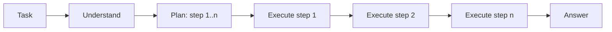

Plan-and-Solve (PS) asks the model to understand the problem, write a plan of subtasks and then carry out the plan step by step. It was introduced by [Wang et al. (2023)](https://arxiv.org/abs/2305.04091) as an improvement over zero-shot [Chain-of-Thought](/ai/chain-of-thought).

The idea: when the model plans and solves at the same time, it tends to skip steps or lose track on long tasks. Separating *what* to do from *doing it* reduces those errors.

## How it works



### 1. Understand the problem

Restate the task and extract the relevant variables, data and constraints. The improved version (PS+) makes this explicit.

### 2. Devise a plan

Break the task into an ordered list of subtasks. Each subtask must be small enough to execute in one step.

### 3. Execute the plan

Carry out each subtask in order. Write intermediate results and check calculations as you go.

### 4. Answer

Combine the results of the subtasks into the final answer.

## Apply Plan-and-Solve

### In a single prompt

The PS+ trigger from the paper, adapted:

```text
First, understand the problem and extract the relevant variables
and their values. Then devise a plan to solve it, as a numbered
list of steps. Then carry out the plan step by step: calculate
intermediate results and check them. Finally, write the answer
on its own line, starting with "Answer:".

Problem: {problem}
```

### In a pipeline or agent

In agents, the same idea is known as **plan-and-execute**: a planner call writes the plan, and executor calls (often [ReAct](/ai/react) agents) handle each step.

```python
plan = call_llm(PLANNER_PROMPT.format(task=task))  # list of steps
results = []
for step in plan.steps:
    results.append(execute(step, context=results))  # executor, may use tools
answer = call_llm(SYNTHESIS_PROMPT.format(task=task, results=results))
```

| Need | Approach |
|---|---|
| The plan breaks in the middle | Add a re-planning step: after each step, the planner can revise the remaining steps |
| Cheaper execution | Use a strong model to plan and a smaller, faster model to execute |
| Human oversight | Show the plan to the user for approval before execution |

## Use cases

- **Long, multi-step tasks**: reports, migrations, data processing with several stages.
- **Word problems and calculations**: where skipped steps cause most errors.
- **Agents with many tools**: a plan keeps the agent focused on the goal.

## Benefits

- **Fewer missing steps**: the plan works as a checklist.
- **Reviewable**: you (or a user) can check the plan before anything runs.
- **Efficient**: the planner runs once, so execution steps can be cheaper.

## Limitations

- A bad plan leads to a bad result. The executor follows it even when it is wrong.
- Static plans do not adapt to new information unless you add re-planning.
- Overhead for short tasks that need only one or two steps.

## How it differs from other frameworks

| Framework | Difference from Plan-and-Solve |
|---|---|
| [HIPA](/ai/hipa) | HIPA structures how the model reasons about a decision (perceive, recall, decide, respond). Plan-and-Solve structures how it executes a task (plan, then do) |
| [Chain-of-Thought](/ai/chain-of-thought) | CoT plans and solves in one stream. Plan-and-Solve writes the full plan first |
| [Self-Consistency](/ai/self-consistency) | Self-Consistency samples many answers and votes. Plan-and-Solve improves a single chain; both can be combined |
| [Tree of Thoughts](/ai/tree-of-thoughts) | ToT keeps several options open and searches. Plan-and-Solve commits to one plan |
| [ReAct](/ai/react) | ReAct decides each step after the last observation. Plan-and-Solve decides all steps up front |
| [Reflexion](/ai/reflexion) | Reflexion improves through retries after failure. Plan-and-Solve tries to avoid failure by planning before acting |
