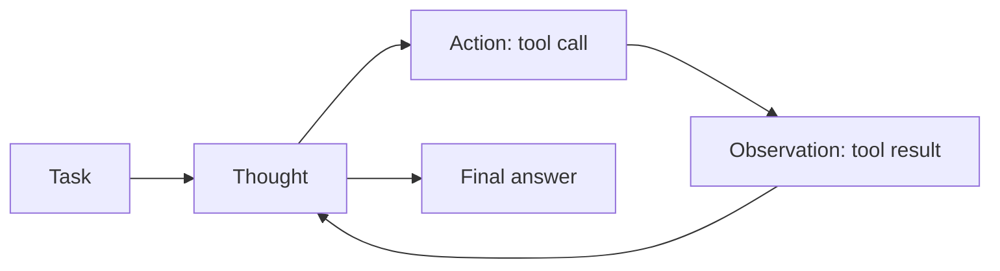

ReAct (Reason + Act) makes the model alternate between thinking, acting with a tool and reading the result. It was introduced by [Yao et al. (2022)](https://arxiv.org/abs/2210.03629) and is the base pattern behind most tool-using agents. See also [Agent loop](/agents/architecture/agent-loop).

The idea: reasoning alone is limited to what the model already knows, and actions alone have no plan. Combined, the reasoning decides what to do next and the observations keep the reasoning grounded in real data.

## How it works



### 1. Thought

The model reasons about the task and the information it has so far, and decides what it needs next.

### 2. Action

The model calls a tool: a search, an API, a database query, a calculator, code execution.

### 3. Observation

The system runs the tool and returns the result to the model as new context.

### 4. Repeat or finish

The model reads the observation and writes a new thought. The loop ends when it has enough information to answer, or when it hits a step limit.

## Apply ReAct

### In a single prompt

The original format uses text markers that the system parses:

```text
Answer the question. You can use these tools: {tools}.

Use this format:
Thought: what you need to do next and why
Action: tool_name[input]
Observation: (the system writes the tool result here)
... repeat Thought / Action / Observation as needed ...
Thought: I have enough information
Answer: the final answer

Question: {question}
```

### In a pipeline or agent

Modern LLM APIs support tool calling natively, so you do not need to parse text markers. The loop is:

```python
messages = [{"role": "user", "content": task}]
for _ in range(MAX_STEPS):
    response = call_llm(messages, tools=TOOLS)
    if not response.tool_calls:
        return response.text  # final answer
    messages.append(response)
    for call in response.tool_calls:
        messages.append(run_tool(call))  # observation
```

| Need | Approach |
|---|---|
| Avoid infinite loops | Set a maximum number of steps and a token budget |
| Safe actions | Validate tool inputs and ask for human approval before irreversible actions |
| Debugging | Log every thought, action and observation as a trace |

## Use cases

- **Question answering over live data**: search, read, then answer with citations.
- **Agents that operate systems**: query APIs, update tickets, run code.
- **Fact checking**: look up each claim instead of trusting the model's memory.

## Benefits

- **Grounding**: answers come from real observations, so fewer hallucinations.
- **Up-to-date information**: tools reach data the model was never trained on.
- **Interpretable**: the trace shows why the agent took each action.

## Limitations

- Quality depends on the tools and their descriptions. A bad tool result leads to a bad answer.
- The model can loop, repeat the same action or stop too early.
- Each step adds a model call, so latency and cost grow with the number of steps.
- Actions have side effects. Errors cost more than in pure reasoning.

## How it differs from other frameworks

| Framework | Difference from ReAct |
|---|---|
| [HIPA](/ai/hipa) | HIPA gathers knowledge in its working memory stage but does not define how. ReAct defines that step as a loop of tool calls |
| [Chain-of-Thought](/ai/chain-of-thought) | CoT reasons only over the existing context. ReAct adds actions that bring in new information |
| [Self-Consistency](/ai/self-consistency) | Self-Consistency samples many chains over the same context. ReAct runs one chain that changes the context with each observation |
| [Tree of Thoughts](/ai/tree-of-thoughts) | ToT searches over possible thoughts. ReAct moves forward one action at a time in the real environment |
| [Plan-and-Solve](/ai/plan-and-solve) | Plan-and-Solve plans everything up front. ReAct decides the next step after each observation (you can combine them: plan, then execute each step with ReAct) |
| [Reflexion](/ai/reflexion) | ReAct reacts to each tool result within one attempt. Reflexion reviews a whole attempt and retries; it often wraps a ReAct agent |
