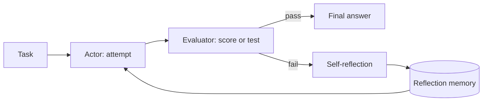

Reflexion adds a feedback loop: the model makes an attempt, gets an evaluation, writes a reflection on what went wrong and uses that reflection on the next attempt. It was introduced by [Shinn et al. (2023)](https://arxiv.org/abs/2303.11366).

The idea is learning from mistakes without retraining the model. The "learning" lives in text: the reflections are stored in memory and added to the prompt of the next try.

## How it works



| Component | Role |
|---|---|
| Actor | Generates the attempt (an answer, code, or a [ReAct](/ai/react) trajectory) |
| Evaluator | Judges the attempt: unit tests, rules, an exact-match check or an LLM judge |
| Self-reflection | Turns the evaluation into a short, specific lesson in natural language |
| Memory | Keeps the reflections from previous attempts and feeds them to the actor |

### 1. Attempt

The actor solves the task as usual.

### 2. Evaluate

The evaluator returns a signal: pass/fail, a score or error messages. External signals (tests, compilers, validators) work best.

### 3. Reflect

The model reads its attempt and the evaluation, and writes what went wrong and what to do differently. For example: "I assumed the list was sorted. Sort it first."

### 4. Retry with memory

The next attempt includes the previous reflections. The loop stops when the evaluator passes or after a maximum number of attempts.

## Apply Reflexion

### In a single prompt

A single-prompt version asks for a draft, a critique and a revision. It has no external evaluator, so it is weaker than the full loop:

```text
1. Write a first answer to the task.
2. Critique it: list errors, missing points and unclear parts.
3. Write an improved final answer that fixes every issue
   from the critique.

Task: {task}
```

### In a pipeline or agent

```python
reflections = []
for attempt in range(MAX_ATTEMPTS):
    output = actor(task, reflections)
    result = evaluate(output)  # for example: run unit tests
    if result.passed:
        return output
    reflections.append(reflect(task, output, result.feedback))
return output  # best effort after the last attempt
```

| Need | Approach |
|---|---|
| Reliable evaluation | Use objective checks (tests, schemas, rules) before falling back to an LLM judge |
| Keep the prompt small | Store only the last few reflections, or summarize them |
| Reuse across tasks | Save useful reflections as long-term memory for similar tasks |

## Use cases

- **Code generation**: run the tests, reflect on failures, fix the code.
- **Agents in multi-step environments**: learn from a failed trajectory and try a better one.
- **Writing with requirements**: check the draft against a rubric and revise.

## Benefits

- **Improves without retraining**: lessons are stored as text, not as model weights.
- **Uses real feedback**: test results and errors guide the next try.
- **Readable lessons**: each reflection explains what changed and why.

## Limitations

- Needs a good evaluator. Without one, the model can "fix" correct answers or accept wrong ones.
- Each retry adds cost and latency.
- Self-critique from the same model can repeat the same blind spots.
- Not suitable when an attempt has irreversible side effects.

## How it differs from other frameworks

| Framework | Difference from Reflexion |
|---|---|
| [HIPA](/ai/hipa) | HIPA uses the user's reaction as feedback for the next turn. Reflexion uses an evaluator to retry the same task automatically |
| [Chain-of-Thought](/ai/chain-of-thought) | CoT is one attempt with no review. Reflexion reviews attempts and tries again |
| [Self-Consistency](/ai/self-consistency) | Self-Consistency samples independent attempts in parallel. Reflexion runs attempts in sequence, each one informed by the last |
| [Tree of Thoughts](/ai/tree-of-thoughts) | ToT corrects course inside one attempt by searching. Reflexion corrects course between full attempts |
| [ReAct](/ai/react) | ReAct reacts to each tool result. Reflexion reacts to the outcome of the whole attempt, and often wraps a ReAct agent |
| [Plan-and-Solve](/ai/plan-and-solve) | Plan-and-Solve prevents errors by planning first. Reflexion fixes errors after they happen |
