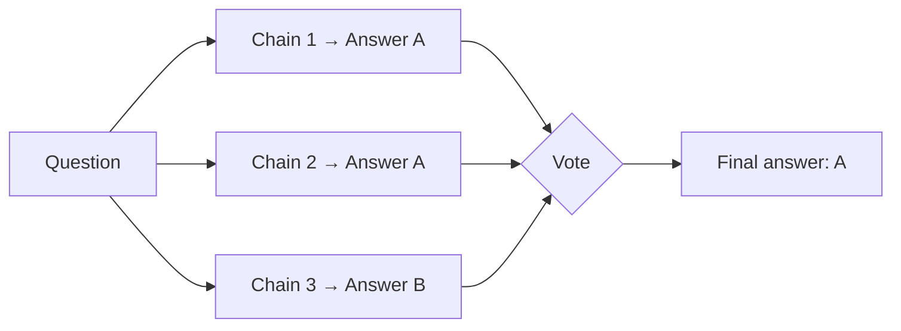

Self-Consistency is a decoding strategy that runs [Chain-of-Thought](/ai/chain-of-thought) several times and keeps the answer most reasoning paths agree on. It was introduced by [Wang et al. (2022)](https://arxiv.org/abs/2203.11171).

The idea: a hard problem has many ways to reason toward the right answer, but wrong reasoning tends to scatter across different wrong answers. When several independent chains reach the same result, that result is more likely to be correct.

## How it works



### 1. Sample several chains

Send the same CoT prompt N times (typically 5 to 20) with a temperature above zero, so each run takes a different reasoning path.

### 2. Extract the answers

Parse the final answer from each chain. Ignore the reasoning at this point: only the answer counts for the vote.

### 3. Aggregate

Pick the answer that appears most often (majority vote). The share of chains that agree is a useful confidence score.

## Apply Self-Consistency

### In a single prompt

Self-Consistency needs several independent calls, so it does not fit in one prompt. The closest single-prompt version asks the model to reason in several ways and compare, but those paths are not independent:

```text
Solve the problem in three different ways. Use a different
approach each time. Then compare the three answers and give the
one that most approaches agree on, starting with "Answer:".

Problem: {problem}
```

### In a pipeline or agent

```python
from collections import Counter

def self_consistency(prompt: str, n: int = 7) -> tuple[str, float]:
    answers = [extract_answer(call_llm(prompt, temperature=0.8)) for _ in range(n)]
    answer, votes = Counter(answers).most_common(1)[0]
    return answer, votes / n  # answer and agreement ratio
```

| Need | Approach |
|---|---|
| Open-ended answers (text, not numbers) | Normalize answers before voting, or ask an LLM to group equivalent answers ("universal self-consistency") |
| Control cost | Stop early when the first K samples already agree |
| Low agreement | Treat it as a signal: escalate to a human or a stronger model |

## Use cases

- **Math and quantitative reasoning**: answers that are easy to compare.
- **Classification and extraction**: labels, categories, yes/no decisions.
- **Confidence estimation**: use the agreement ratio to decide when to trust an answer.

## Benefits

- **Accuracy**: consistent gains over single-chain CoT on reasoning benchmarks.
- **Confidence signal**: agreement tells you how sure the system is, for free.
- **No training**: works with any model and any CoT prompt.

## Limitations

- Cost and latency grow linearly with the number of samples.
- Needs answers that can be compared. Voting on long free-form text is hard.
- If the model has a systematic bias, all chains can agree on the same wrong answer.
- Parallel calls help latency, but not cost.

## How it differs from other frameworks

| Framework | Difference from Self-Consistency |
|---|---|
| [HIPA](/ai/hipa) | HIPA structures one reasoning process into stages. Self-Consistency repeats an unstructured process and votes |
| [Chain-of-Thought](/ai/chain-of-thought) | CoT is one chain. Self-Consistency is many CoT chains plus a vote |
| [Tree of Thoughts](/ai/tree-of-thoughts) | ToT evaluates and prunes paths *during* the reasoning. Self-Consistency only compares final answers *after* all chains finish |
| [ReAct](/ai/react) | ReAct gets new information from tools. Self-Consistency only reasons over the same context several times |
| [Plan-and-Solve](/ai/plan-and-solve) | Plan-and-Solve improves one chain by planning first. Self-Consistency improves reliability by sampling many chains; you can combine both |
| [Reflexion](/ai/reflexion) | Reflexion improves answers sequentially with feedback. Self-Consistency samples in parallel with no feedback between runs |
