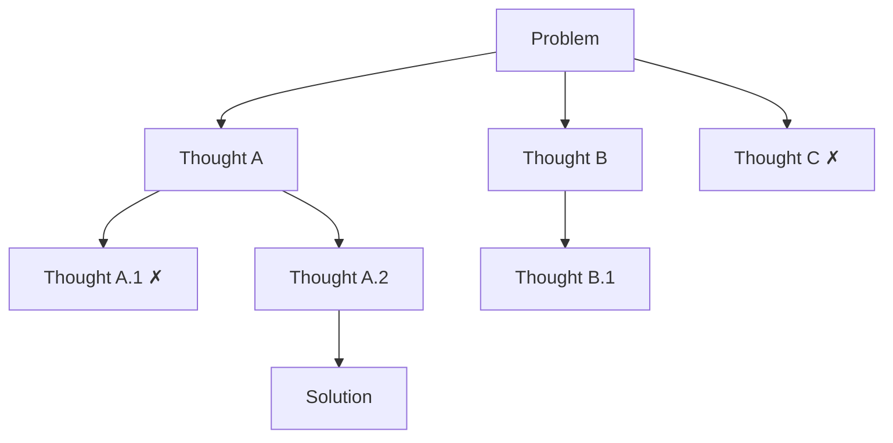

Tree of Thoughts (ToT) turns reasoning into a search problem. Instead of writing one chain of steps, the model proposes several possible next steps, evaluates them, keeps the promising ones and can backtrack from dead ends. It was introduced by [Yao et al. (2023)](https://arxiv.org/abs/2305.10601).

The idea comes from how people solve puzzles: try an option, see if it leads somewhere, and go back if it does not.

## How it works



ToT has four components:

| Component | Question it answers |
|---|---|
| Thought decomposition | What is one "step" for this problem? A line, a move, a paragraph? |
| Thought generation | How do you get candidate next steps? Sample several, or ask for a list |
| State evaluation | How good is each partial solution? Score it (1–10) or vote ("sure / maybe / impossible") |
| Search algorithm | Which branches do you expand? Breadth-first (BFS) or depth-first (DFS) with backtracking |

### 1. Generate candidate thoughts

From the current state, the model proposes several possible next steps.

### 2. Evaluate each state

The model (or a separate evaluator prompt) rates how promising each partial solution is.

### 3. Search and prune

Keep the best K states and expand them. Drop branches that score low. Backtrack when a branch fails.

### 4. Return the best solution

Stop when a state solves the problem or the search budget runs out.

## Apply Tree of Thoughts

### In a single prompt

A single-prompt version simulates the tree, with less rigor than a real search:

```text
Imagine three experts solving this problem together.
Each expert writes one step of their reasoning, then shares it.
After each round, any expert whose step is wrong leaves.
Continue until the remaining experts agree on a solution.

Problem: {problem}
```

### In a pipeline or agent

```python
def tree_of_thoughts(problem: str, depth: int = 3, breadth: int = 3, keep: int = 2):
    states = [""]
    for _ in range(depth):
        candidates = [s + t for s in states for t in propose(problem, s, n=breadth)]
        scored = sorted(candidates, key=lambda c: evaluate(problem, c), reverse=True)
        states = scored[:keep]  # prune
    return states[0]
```

Use separate prompts for `propose` and `evaluate`. The evaluator works better when it can check the state against hard rules (for example, a constraint or a test).

## Use cases

- **Puzzles and planning**: problems where early choices block later ones (Game of 24, crosswords, scheduling).
- **Creative writing with constraints**: generate several outlines, pick the best, then expand.
- **Design exploration**: compare architecture or solution options before committing to one.

## Benefits

- **Handles dead ends**: backtracking recovers from early mistakes that would ruin a single chain.
- **Explicit evaluation**: every kept branch has a score you can inspect.
- **Big gains on search problems**: much better than CoT where exploration matters.

## Limitations

- Expensive: many calls per problem (generation plus evaluation at every level).
- You must design the step, the evaluator and the search for each problem type.
- The evaluator is the weak point: if it scores badly, the search goes the wrong way.
- Little benefit for problems that do not need exploration.

## How it differs from other frameworks

| Framework | Difference from Tree of Thoughts |
|---|---|
| [HIPA](/ai/hipa) | HIPA compares alternatives once, in its decision stage. ToT compares alternatives at every step and searches across them |
| [Chain-of-Thought](/ai/chain-of-thought) | CoT follows one path with no evaluation. ToT branches, scores and backtracks |
| [Self-Consistency](/ai/self-consistency) | Self-Consistency runs full chains and votes at the end. ToT evaluates partial solutions and prunes during the search |
| [ReAct](/ai/react) | ReAct explores the outside world with tools. ToT explores the space of possible reasoning steps |
| [Plan-and-Solve](/ai/plan-and-solve) | Plan-and-Solve commits to one plan. ToT keeps several options open until it finds the best one |
| [Reflexion](/ai/reflexion) | Reflexion retries after a full attempt fails. ToT evaluates and corrects inside a single attempt |
